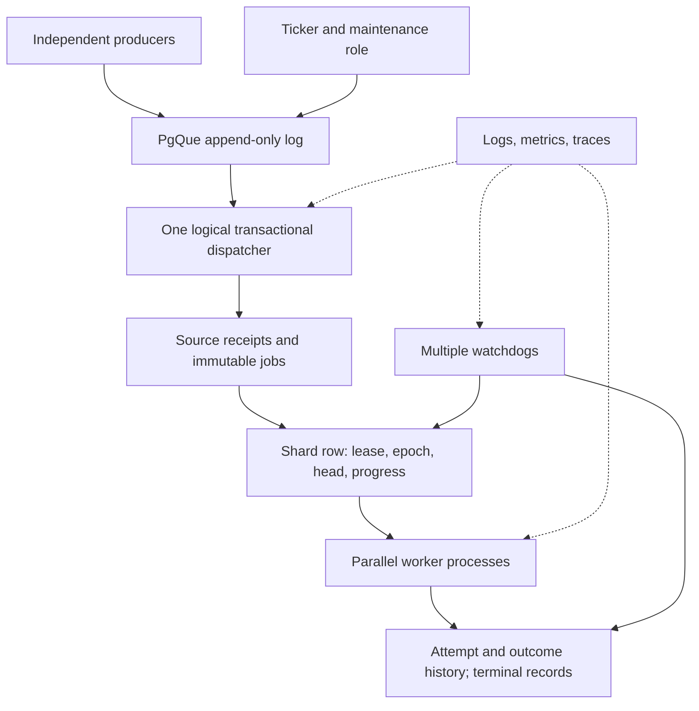

# Slice 0 — Research, audit, and architecture

Date: 2026-10-18. Decision state: **PROPOSED; awaiting user architectural approval**.
Scope: documents and Git setup only. No application, migrations, project containers, or executable system tests have been created. Source-supported design is not runtime proof.

## A. What we built

Created the private `mizuharaa/pgHelm` repository and linked the local checkout at `C:\Users\Khang\pgHelm`. Established isolated source-audit and Claude-QA worktrees. Inspected the development tools, official PgQue/PostgreSQL material, and the assembled PgQue release installer. This document proposes the execution protocol and defines tests that could falsify it; no engine behavior works yet.

## B. Why we designed it this way

### Research baseline and pins

| Component | Inspected / proposed pin | Evidence and status |
|---|---|---|
| PgQue | v0.2.2, commit `dff3a906276068ad2433312bbc7c95a577deff53` | GitHub latest release query and detached source checkout agree; release published 2026-10-04. Use `sql/pgque.sql`, not `devel/sql` or floating main. |
| PgQue installer | Canonical Git-blob SHA256 `1f96dde1e57d0e97e6418a4e02b76fe2bf2e7688c5fbdc812160c57baba84030` | Measured on exact `git show HEAD:sql/pgque.sql` bytes. Windows checkout uses CRLF and hashes to `0e33130bbd673549e6aae6abdcd5de3c05bfe9bcfac6bef4173ac713349c3772`. Vendor canonical LF bytes and enforce LF in Slice 1. |
| PostgreSQL | `postgres:17-bookworm@sha256:3645570cccdfa447589da9f57dd740faa29b30938e861289a5574b6ca6b03826` | Registry index inspected; amd64 manifest reports 17.11-bookworm. Not pulled or run for this project. Record `SELECT version()` in Slice 1. |
| Node | 24.21.0, proposed supported LTS alternative to 22 | Installed locally; Node's [release policy](https://nodejs.org/en/about/previous-releases) lists 24 as LTS. Prefer current installed supported LTS over adding another runtime; exact pin in Slice 1. |
| pnpm | 9.15.9 | Installed; sufficient for one small package. Pin in `packageManager` in Slice 1. |

Upstream main resolved separately to `4a522584a112fc06f4443210ae7ca89e13d4ed63`; it is **not** our chosen pin. Website documentation can describe newer code, so the release SQL wins for behavioral claims.

### PgQue findings

The following are **SOURCE-CONFIRMED**, not tests run against PostgreSQL. All source links use the pinned release. The official [overview](https://pgque.dev/docs/), [concepts](https://pgque.dev/docs/concepts/), [reference](https://pgque.dev/docs/reference/), [examples](https://pgque.dev/docs/examples/), and [installation guide](https://pgque.dev/docs/installation/) were inspected as context.

| Question | Finding | Pinned evidence / falsifying test |
|---|---|---|
| What does receive return? | A snapshot-defined next batch from `next_batch` / `get_batch_events`; an open batch is reused. Empty tick windows are finished internally. It is not `event_id > last_id`. | [receive](https://github.com/NikolayS/PgQue/blob/dff3a906276068ad2433312bbc7c95a577deff53/sql/pgque.sql#L5342), [normal batch override](https://github.com/NikolayS/PgQue/blob/dff3a906276068ad2433312bbc7c95a577deff53/sql/pgque.sql#L5657). Tests S1-02/03/06. |
| What does ack do? | Calls `finish_batch`; locks subscription, moves last tick to next tick, clears open batch. Returns 1 when found, 0 when absent. Require 1 for a nonempty dispatched batch; 0 is not successful handoff. | [final finish_batch](https://github.com/NikolayS/PgQue/blob/dff3a906276068ad2433312bbc7c95a577deff53/sql/pgque.sql#L5884). S1-02/04. |
| Can receive, application writes and ack share a transaction? | Yes: these are transactional SQL functions, with no independent commit. The consumer row lock is held through transaction end. Use one checked-out `pg` client and one database. | [lock at line 5766](https://github.com/NikolayS/PgQue/blob/dff3a906276068ad2433312bbc7c95a577deff53/sql/pgque.sql#L5766), [official example](https://pgque.dev/docs/examples/#exactly-once-processing). S1-04/08, then Slice 2 fault injection. |
| Does a limit paginate? | No. The `(limit + 1)`th event raises SQLSTATE 54000 and aborts the call; exactly limit events is allowed. NULL disables the ceiling; we will not use NULL. Ticker count is a trigger, not a hard batch cap. | [overflow check](https://github.com/NikolayS/PgQue/blob/dff3a906276068ad2433312bbc7c95a577deff53/sql/pgque.sql#L5366). S1-05. |
| Where does a new consumer start? | Latest **existing tick**, not the beginning of retained history or an exact wall-clock subscribe instant. Already registered consumers preserve their position unless explicitly repositioned. Provision consumer before enabling producers; treat accidental missing consumer as a startup error. | [register_consumer_at](https://github.com/NikolayS/PgQue/blob/dff3a906276068ad2433312bbc7c95a577deff53/sql/pgque.sql#L1782), especially 1860–1876. S1-07 includes an event between latest tick and subscribe. |
| Producer/ticker ordering? | Event membership depends on transaction snapshots. Separate producer commit, ticker commit, and consumer transaction. A smaller event ID can commit after a larger one; never replace snapshot membership with an ID watermark. | [batch visibility implementation](https://github.com/NikolayS/PgQue/blob/dff3a906276068ad2433312bbc7c95a577deff53/sql/pgque.sql#L2178). S1-03 with controlled two-producer commit inversion. |
| What maintenance is needed? | Local application scheduler can call public ticker and maintenance functions. `maint()` deliberately skips rotation step 2 and VACUUM. Schedule `maint_rotate_tables_step2()` separately in its own committed transaction, alongside `maint()` and `maint_retry_events()`. | [maint](https://github.com/NikolayS/PgQue/blob/dff3a906276068ad2433312bbc7c95a577deff53/sql/pgque.sql#L5254), rotation source and pinned installation docs. S1-09; long-horizon behavior still UNVERIFIED. |
| Coop/retry/DLQ already exist? | Cooperative batch assignment, stale-member takeover and heartbeat ship but are explicitly experimental. Normal delivery supports retry scheduling and DLQ; `nack` consults retry budget. These are upstream features, not pgHelm inventions. | [coop warning](https://github.com/NikolayS/PgQue/blob/dff3a906276068ad2433312bbc7c95a577deff53/sql/pgque.sql#L6665), [nack](https://github.com/NikolayS/PgQue/blob/dff3a906276068ad2433312bbc7c95a577deff53/sql/pgque-api/receive.sql). Exclude cooperative API from v1; verify normal API use in S1-10. |
| What survives rollback? | Committed producer events persist. Dispatch rollback undoes receipt/inbox writes and cursor advancement, including empty-batch auto-ack. Sequence allocations may leave gaps; gaps are not lost committed jobs. | SQL transaction composition; S1-04/06. Crash and ambiguous COMMIT remain runtime-unverified. |

**Critical handoff assessment:** safe as a proposed same-database atomic transaction, conditional on full-batch staging, durable invalid-event disposition, checked ack return, and retained subscriber identity. It is unsafe if receive/ack use independent pool queries, a partial result is acknowledged, an unknown consumer is silently recreated, or external work runs inside the transaction. Exactly-once external execution does not follow from atomic ingestion.

PgQue normal consumers are not per-job worker claims. Their internal subscription lock protects cursor mutation when receive and ack stay inside one transaction. However, Claude identified a possible READ COMMITTED join-recheck error when a receive statement waits behind a concurrent ack: the updated subscription may be rechecked against an older joined tick row and raise the missing-tick sanity error (pinned SQL 5727–5799). This is **UNVERIFIED**, source-derived reasoning; S1-08 must establish actual behavior.

Revised proposal: v1 uses one queue and one logical dispatch consumer, with a transaction-scoped advisory lock taken in a **separate SQL statement before receive**. Use a reserved pair of integer keys for this one pipeline, shared by every dispatcher and documented in configuration; migration locks use a different pair. `pg_try_advisory_xact_lock` returning false ends the empty transaction and backs off. Only after obtaining it does the next receive statement take its snapshot. This avoids the proposed overlap without session-affinity requirements, a separate leader lease, or direct writes to PgQue internals. All pgHelm inbox writers obey this gate. An uncoordinated operator consuming the same subscription is outside this protocol and must be prevented operationally. Do not classify all PgQue corruption errors as transient. The extra gate is a review-driven proposal, pending architectural approval.

### ADR-001 — Execution storage (proposed)

| Criterion | A: immutable jobs/history + bounded shard state | B: mutable job state + history |
|---|---|---|
| Pending lookup | Index seek `(shard_id, ingest_seq)` beyond shard progress; no history-wide anti-join | Partial index of pending rows ordered by eligibility |
| Index requirements | Unique job/source identities, shard-order index, per-job attempt index, terminal PK | Identity indexes plus mutable scheduling/state indexes and history indexes |
| Crash recovery | Durable start intent + current shard head; locked recovery writes outcome | Reclaim running rows using lease/attempt ownership and append history |
| Retry | One shard head with attempt count and next eligibility; HOL blocking | Update job eligibility; easier out-of-order progress |
| Storage | More immutable records; retained histories and identity ledger grow | Obsolete row versions plus histories; vacuum-sensitive |
| Write amplification | Receipt + job insert; start/outcome/terminal inserts; shard UPDATEs per transition and renewal | Job UPDATEs per start/retry/finish, plus history and coordination writes |
| Retention | Completed prefix makes eligibility clear; identity tombstones still needed | Delete terminal rows in batches; same identity-tombstone issue |
| Complexity | Tractable only with one serialized ingestion lane and one head per shard | Simpler flexible scheduler; more mutable per-job state |

**Recommendation: A, narrowly constrained.** Jobs and history append; only coordination rows mutate. This is not a zero-write-amplification design. The fixed-cardinality shard table can still accumulate many dead tuple versions under held xmin. Extra inserts may generate more WAL than B; benchmark both before making a storage claim. If independent retries or priority scheduling become necessary, revisit this ADR rather than silently add a second scheduler.

### ADR-002 — Ordering, shard ownership and time (proposed)

Fixed shard count for v1. Hash UTF-8 grouping key (fallback logical job UUID) with Node's SHA-256, first unsigned big-endian 32 bits modulo shard count; persist shard ID and routing version with the job. Never change shard count in place. No DB `hashtext` portability assumption.

The dispatcher allocates engine `ingest_seq` only **after acquiring the dispatch transaction gate and receiving the batch under PgQue's consumer lock**, in deterministic order within the received batch. Its sequence must be `CACHE 1 NO CYCLE`, with no preallocation, reseeding or external callers: cached ranges held by different sessions could otherwise reverse numeric order despite serialized transactions. All inbox writers use this lane; replay of quarantine must publish a new corrected event through it, never insert behind a shard watermark. One transaction commits before the next can allocate job order. Rollback leaves harmless sequence gaps. This makes **engine ingestion order per shard** usable for a progress cursor; source sequence values alone cannot provide that guarantee. No global FIFO, producer commit FIFO, or wall-clock creation FIFO is claimed. Retry of a head job blocks later jobs in that shard; other shards continue.

Use READ COMMITTED with explicit shard row locks for ownership transitions. Acquire `SELECT ... FOR NO KEY UPDATE` on the shard by ID **without a time predicate**, then sample database `clock_timestamp()` in a subsequent statement and revalidate owner, epoch, deadline, head and attempt. The same lock protects acquisition, renewal, attempt start, completion, failure, recovery and graceful release. Lock order: shard, then its job/attempt/outcome. Shard primary keys are immutable; coordination changes no referenced unique key.

Dispatch's job-to-shard FK takes an implicit KEY SHARE lock. `FOR NO KEY UPDATE` is deliberately compatible with that lock while mutually excluding other coordination transitions. `FOR UPDATE` would unnecessarily couple whole-batch dispatch to lease renewals. There are still table/index/WAL and other FK costs; no claim of lock-free dispatch. Slice 3 must exercise dispatch inserts versus renewal/ownership transitions with two connections, and verify schema/index changes have not upgraded coordination lock mode.

Candidate discovery for acquisition/watchdog uses a bounded shard-ID scan and `FOR NO KEY UPDATE SKIP LOCKED`, followed by fresh-time revalidation under the acquired lock. Process one shard per transaction; never hold a set of C shard locks while starting C jobs. Specific already-owned-shard transitions may wait with lock timeout. If a future operation truly needs several shard locks, ascending shard_id is mandatory and requires a new concurrency test. Skipping a busy candidate is not proof of its health; rescan at the next bounded polling interval.

`now()` is transaction-start time. A transaction that waits several seconds can use stale `now()` and mistakenly renew an expired lease. `clock_timestamp()` after lock acquisition gives the actual database wall time at validation. Database time can jump; monotonic epochs and row serialization provide fencing, while deadlines govern liveness. A backward clock jump can delay recovery; a forward jump can cause early takeover and duplicate external effects. [PostgreSQL time semantics](https://www.postgresql.org/docs/17/functions-datetime.html#FUNCTIONS-DATETIME-CURRENT), [row locks](https://www.postgresql.org/docs/17/explicit-locking.html#LOCKING-ROWS).

Acceptance linearizes at the final locked validity check immediately preceding outcome/terminal writes. A transaction that passes before expiration may commit after expiration while blocking takeover; a superseding epoch can never commit first and then accept that old completion. We do not promise that COMMIT's wall clock is before lease expiry. Keep finalization short with database transaction/statement/idle timeouts. Test both orders of this race explicitly.

One **authorized** attempt runs per shard. An expired worker may continue executing CPU or an external request while its replacement runs: leases cannot stop a paused process. Cancellation and abort signals are best effort; accepted database writes are fenced. External systems need their own stable idempotency contract or fencing support.

### ADR-003 — Polling, maintenance and retries (proposed)

One application with independent dispatcher, worker, watchdog and ticker roles; no new broker or inter-role HTTP calls. Use a small root pnpm package initially; a workspace adds no useful boundary yet. Use `pg` directly instead of the PgQue SDK so transaction-client ownership stays explicit.

Local ticker role calls `pgque.ticker()` every 100 ms in separate committed transactions, `maint()` and `maint_retry_events()` every 30 s, and `maint_rotate_tables_step2()` every 10 s in a separate transaction. No overlapping calls for a task; skip missed schedule slots rather than create an unbounded catch-up queue. These are initial settings to verify and measure, not latency promises. Keep maintenance off the dispatch connection. No pg_cron dependency for local v1; pg_cron remains an operational alternative.

The pinned low-level maintenance functions require administrative privileges. For this synthetic v1 deployment, the dedicated maintenance login has `pgque_admin`, which inherits reader/writer and can alter PgQue state. It is a **trusted administrative principal**, not a least-privilege consumer. Isolate its credentials from worker/producer roles; no user-controlled SQL reaches it. Narrow owned SECURITY DEFINER maintenance wrappers are a possible later hardening change, not an unimplemented privilege claim. S1-10 tests and documents actual grants, including this exception.

Use fixed bounded dispatch/worker polling first, with a sleep after empty polls or transient failures. Configurable per-process work cap C; acquire at most C shards with one running head each. Pool bounds, wait queue bounds and role counts must be reported; a per-process bound is not a cluster-global connection cap. Conservatively default C=4, worker pool=6, dispatcher=1, watchdog=2, ticker=2 in later slices, and validate deployment totals against database capacity. Lease duration=15 s and renewal=5 s are proposed test defaults, not recovery results.

PgQue ticker already issues NOTIFY; choosing polling does **not** remove its notification overhead. Add no producer-level NOTIFY. [Recall.ai's incident](https://www.recall.ai/blog/postgres-listen-notify-does-not-scale) motivates measuring contention, not assuming it occurs at our tick rate. [DBOS's design](https://www.dbos.dev/blog/postgres-is-all-you-need-for-durable-execution) supports direct database coordination; pgHelm intentionally excludes workflow checkpoint replay. [Brandur's failure study](https://www.brandur.org/postgres-queues) motivates held-xmin tests, not a blanket claim that indexed mutable queues fail.

Once transferred, only pgHelm retries jobs. Use bounded exponential delay `min(cap, base * 2^(attempt_no - 1))`, cap the exponent before arithmetic overflow, and no jitter initially for deterministic tests. An attempt-start intent consumes the retry budget even if the process dies before entering the handler; this prevents infinite crash loops but may terminally fail a job whose business logic never ran. Record that distinction. Proposed defaults: five total starts, 1 s base, 60 s cap. Timestamps and budget updates commit with the outcome. Do not call PgQue nack for an already-staged job.

## C. Architecture changes and transaction boundaries

No running architecture changed. Proposed flow:



```text
Producer TX: BEGIN -> validate/enqueue -> COMMIT
Ticker TX:   capture snapshot / tick -> COMMIT (independent of producer)

Dispatch TX, ONE pg client, ONE database:
BEGIN READ COMMITTED
  SET LOCAL timeouts
  try transaction advisory dispatch lock; if unavailable, end TX and back off
  receive complete batch (consumer row lock held until transaction end)
  validate raw events; accepted / duplicate / quarantine disposition for EVERY event
  insert immutable canonical jobs + source receipts; assert full identity coverage
  ack(batch_id); require result=1 for a nonempty batch
COMMIT
  loss of commit response => outcome unknown; reconnect and reconcile, never undo

Start TX: lock shard -> fresh DB time + owner/epoch check ->
  select first job beyond progress -> append attempt intent + set head -> COMMIT
Handler: run OUTSIDE every database transaction
Finish TX: lock shard -> fresh DB time + owner/epoch/head/attempt check ->
  append outcome and terminal OR retry schedule -> update shard progress/head -> COMMIT

Recovery TX: lock candidate shard -> recheck expiration and epoch ->
  invalidate owner with epoch increment -> append abandoned outcome / retry or terminal ->
  record recovery transition -> COMMIT
Acquire TX: lock unowned/expired shard -> reconcile abandoned head if needed ->
  increment epoch, assign unique process incarnation owner and deadline -> COMMIT
```

For nonempty dispatch, all returned rows must share one batch ID. A new source tuple `(source_generation UUID, msg_id bigint)` is either accepted, a verified duplicate linking the canonical job, or quarantined with raw payload and reason. Source generation is fixed configuration per queue incarnation; queue drop/recreate requires a new generation and explicit provisioning. No timestamps or payload hashes substitute for source identity.

Job identity uses UUID plus unique `(idempotency_scope, idempotency_key)` with non-null scope (default scope allowed). An exact repeated job ID/key and equal canonical envelope maps to the same job. Reused ID/key with differing job type, schema, grouping key or payload is quarantined; do not silently `ON CONFLICT DO NOTHING`. Different IDs reusing an existing key are treated as conflicts unless a later ADR permits aliasing. Store the original bytes and parsed accepted envelope; bound payload size before enqueue. Timestamp/idempotency fields are fixed across producer retry.

Classify every envelope before job insertion: parse/validate in the application, compare bounded existing-identity lookups, and deduplicate conflicting identities within the batch in deterministic order. PostgreSQL constraints remain assertions, not the normal quarantine classifier. Validate strings that PostgreSQL jsonb cannot represent (including decoded NUL/unpaired surrogates) before jsonb writes; retain source text for quarantine. PostgreSQL text has already enforced database encoding, so producer invalid-encoding rejection is tested separately from source text containing JSON escapes. Unexpected constraint failure rolls back the batch, emits a fingerprinted error, and after three consecutive same-batch failures stops polling that pipeline pending operator diagnosis; no tight infinite loop. Tests must include same-batch duplicate IDs/keys, changed envelopes, malformed JSON, unsupported schemas and jsonb-incompatible strings. Every source must remain accounted for, including quarantined poison events.

Oversize batch: rollback, log and alert, stop advancing this consumer. Never increase limits without a resource-budget decision or skip the batch. The operational recovery is a reviewed larger ceiling or complete-batch lower-level processing, still one atomic handoff; implementing a streaming path is deferred. An oversized record from a privileged/bypassing producer can still create storage/resource trouble; SQL receive's set-returning function may materialize/spill server-side. Set statement/temp limits and test memory behavior. Backpressure can preserve correctness while sacrificing liveness.

## D. Database changes — proposed model only

No DDL has been run. All tables below belong to our own schema, not PgQue's private schema. All IDs that are bigint remain strings/BigInt in Node, never unsafe JS numbers. Timestamps are timestamptz; application role access is parameterized and least-privilege.

| Table | Purpose and important columns | Constraints / indexes | Transactions, access and storage consequences |
|---|---|---|---|
| `ingress_event` | Durable receipt/quarantine: source_generation, msg_id, batch_id, raw_payload text, raw_type, source_created_at, disposition, job_id nullable, reason, staged_at | PK `(source_generation,msg_id)`; FK job_id; CHECK accepted/duplicate requires job_id, quarantined requires reason and no runnable job; index `(disposition,staged_at)` for operator review | One insert per source event in dispatch TX, including duplicates and invalid JSON. Point lookups on replay; immutable after ingest. Raw payload duplicates data intentionally for audit and conflict verification; storage measured. |
| `job` | Immutable canonical inbox: job_id UUID, ingest_seq bigint, scope/key, type, schema_version, grouping key, routing version, shard_id, producer_created_at, staged_at, payload jsonb | PK job_id; UNIQUE scope/key; UNIQUE ingest_seq; index `(shard_id,ingest_seq)`; positive schema/routing versions; shard FK once shard schema exists | Insert once in dispatch TX; indexed seek for next shard job. No per-job status UPDATE. Identity indexes and payload retention still cost WAL/disk. Never use original event ID as progress. |
| `shard` | Bounded mutable coordination: shard_id, owner UUID nullable, epoch bigint, expires_at, renewed_at, progress_seq, current_job_id nullable, active_attempt_id nullable, attempt_count, next_attempt_at | PK shard_id; nonnegative epoch/progress/count; FKs to current job/attempt where valid; head/attempt consistency enforced by transition functions and tests; scan fixed shard set initially (no mutable expiration index) | Every transition locks row; renewal UPDATEs same row. Progress advances only with durable terminal outcome. Repeated writes can bloat this small table under held xmin; fixed row count is not fixed physical size. Epoch never reset and overflow fails closed. |
| `attempt` | Start intent: attempt_id UUID, job_id, attempt_no, shard_id, owner, epoch, started_at | PK attempt_id; UNIQUE `(job_id,attempt_no)`; job FK; CHECK attempt_no>0 | Insert in locked start TX before invoking handler. Per-job ordered lookup; immutable. It records authorization/intention, not proof handler code ran. |
| `attempt_outcome` | One engine result per start: attempt_id, kind (success/retry/abandoned/terminal_failure), recorded_at, bounded error_code/reason, next_attempt_at nullable | PK/FK attempt_id; CHECK retry fields/kind consistency | Worker finalization or fenced recovery inserts once under shard lock. Uniqueness arbitrates conflicting resolution; crash/ambiguous handler result stays distinguishable. No UPDATE of attempt row needed. |
| `terminal` | Canonical logical completion or terminal failure: job_id, attempt_id, kind, accepted_at, bounded result/reference | PK/FK job_id; UNIQUE attempt_id; FK outcome; CHECK success/failure kinds and valid outcome mapping via transition function | Insert with successful finalization or exhaustion and shard progress in same TX. One identity covers success AND failure; separate independent unique constraints on success/failure tables would allow both. Point lookup supports reconciliation. |
| `coordination_event` | Auditable acquire/release/expire/recovery transitions: event_id, shard_id, epoch, owner, kind, occurred_at, reason | PK event_id; index `(shard_id,event_id)`; UNIQUE `(shard_id,epoch,kind)` for epoch transition events | Append in transition TX. Renewal success goes to logs/metrics rather than an append for every heartbeat; renewal failures logged. History grows with ownership churn and needs retention. |

Do not create all seven tables in Slice 1. Slice 2 introduces inbox/receipts; Slice 3 coordination and completion fencing seams; Slice 4 full attempt lifecycle. SQL migration ordering must avoid circular FK creation (add active-attempt FK after attempt table). Exact DDL is subject to this architectural approval and each slice plan.

Shard worker role must not have arbitrary INSERT/UPDATE rights to acceptance/coordination tables. Proposed narrow database transition functions (fixed search_path, checked inputs and roles) hold lock through validation and writes; they are the fencing boundary. Source inspection of a TypeScript helper is insufficient to claim database-enforced fencing. Dispatcher role alone writes ingress/inbox; producer cannot ack; workers do not receive PgQue consumer rights. PgQue's reader role is broad and is **not** a tenant isolation boundary. All v1 producers/operators are trusted deployment principals, not mutually hostile tenants.

### Ownership state machine and two-worker timeline

```text
unowned(epoch n) --acquire--> owned(A,n+1,deadline)
owned(A,n) --valid renewal--> owned(A,n,new deadline)
owned(A,n) --expired recovery--> unowned(n+1) + durable recovery outcome
owned(A,n) --expired direct takeover--> owned(B,n+1) + same recovery arbitration
owned(A,n) --graceful release after settled head--> unowned(n+1)
```

| Time | Worker A | Worker B / watchdog | Durable rule |
|---|---|---|---|
| t0 | Locks unowned shard, takes epoch 7, commits | Waits on same row | Only A's valid acquisition commits |
| t1 | Appends attempt 1, commits, handler starts | Sees unexpired A lease, cannot take it | One authorized attempt |
| t2 | Pauses past deadline | Locks row, checks fresh DB time, records abandoned attempt and takes epoch 8 | Recovery and epoch change commit together |
| t3 | Resumes, locks shard to complete with epoch 7 | Holds epoch 8 | A is rejected without accepted outcome/terminal insert |
| t4 | May have already made external effect | Starts retry attempt 2, executes idempotently, commits terminal under epoch 8 | At-least-once attempts, one accepted terminal identity |
| alternate | A locks and validates BEFORE expiry; delayed transaction still holds lock | B waits, then sees terminal/progress after A commits | Completion precedes takeover in DB serialization; test boundary across expiry |

Never renew an already expired lease under the same epoch. Reacquire with a new epoch and reconcile any open intent. On an ambiguous acquisition COMMIT, do not start work until ownership is read back and revalidated. On ambiguous completion COMMIT, query terminal/outcome identity before retrying handler logic. A successful repeated API call may report already-terminal; it must not manufacture a new accepted completion.

### ADR-004 — Retention and failure model (proposed)

v1 begins with unpartitioned execution tables and **cleanup disabled** until terminal-prefix and identity retention tests pass. Disk growth is explicit and observable, not bounded by append-only design. For initial measured runs retain all records; record duration and initial sizes.

Later bounded cleanup may select terminal jobs older than configured audit retention and behind each shard's committed progress, under the shard lock/recheck, delete child records in FK-safe order, and preserve deduplication identities. Pending/retrying/current head never qualifies. Conservatively retain source/job/idempotency identity records indefinitely in the initial release; payload/history purge requires a reviewed tombstone representation and replay horizon. This intentionally leaves an unbounded identity ledger, a capacity limitation to measure and disclose. No autonomous time-based drop of execution partitions is authorized by this design.

Partitioning is deferred until measured size warrants it. PostgreSQL 17 partitioned uniqueness includes partition keys, which complicates global source/job uniqueness. Partition detach/drop needs explicit lock budgets and conservative retries. PgQue rotation has its own horizon and cannot authorize deletion of our data. TRUNCATE takes ACCESS EXCLUSIVE, is transactional, and is not MVCC-safe in the same manner as ordinary row deletes. [Partition constraints](https://www.postgresql.org/docs/17/ddl-partitioning.html#DDL-PARTITIONING-DECLARATIVE-LIMITATIONS), [TRUNCATE](https://www.postgresql.org/docs/17/sql-truncate.html).

Failure model: one primary PostgreSQL database, durable WAL settings (`fsync`, `synchronous_commit`, `full_page_writes` enabled), process/connection failures, delays and transactional rollback. No proof against disk destruction, operator corruption, asynchronous replica promotion losing commits, or external service non-idempotency. Database outages halt progress; recovery assumes DB returns, scheduler operates, some worker is available, and resource ceilings permit the head batch/job. No automatic failover or production deployment in v1 scope.

## E. File changes and proposed repository structure

Slice 0 adds `README.md`, `AGENTS.md`, `docs/slice-0.md`, and `docs/review-log.md`. Dependencies installed: **none**. External upstream checkout is research material, outside pgHelm. Worktree paths: `C:\Users\Khang\pw\pghelm-source-audit` and `C:\Users\Khang\pw\pghelm-claude-qa`.

Future structure (not scaffolded):

```text
package.json, pnpm-lock.yaml, tsconfig.json, eslint.config.js, vitest.config.ts
src/db.ts, src/config.ts, src/cli.ts
src/dispatcher/, src/worker/, src/watchdog/, src/telemetry/
migrations/                  # versioned owned SQL, checksum ledger
vendor/pgque/                # pinned installer, license and checksum
tests/integration/, tests/unit/
infra/compose.yaml           # PG17 initially; metrics/dashboard later
benchmarks/                  # only when measurement slice is approved
docs/                       # decisions, protocols, evidence, runbook
.github/workflows/ci.yml
```

Slice 1 dependencies: `pg`, Zod, Pino; dev TypeScript, @types/node, @types/pg, Vitest, Testcontainers PostgreSQL support, ESLint/TypeScript ESLint, and a single TS execution tool only if Node's native execution does not cover the agreed module setup. Pin exact versions and lockfile then, after checking compatibility. No ORM. Prometheus client, OpenTelemetry, Grafana, Prometheus and k6 are deferred to the slices that need them, not added speculatively. pnpm workspace only if multiple separately built packages actually emerge.

## F. Checks actually executed

Environment/tool probes were executed and output observed; they are **not integration tests**. Fresh final probes record explicit exit codes in the review log. No typecheck/lint/test command exists yet, and no test-pass count is claimed.

| Command | Observed result | Property / status |
|---|---|---|
| `git rev-parse --show-toplevel` from original home directory | Fatal: not a git repository | Expected negative; starting directory was home, not an existing project |
| `Get-Command git,gh,node,pnpm,docker,psql,claude,codex` | All eight commands located | Tool discovery only |
| `git --version`; `gh --version` | 2.55.0.windows.3; 2.100.0 | Available |
| `node --version`; `pnpm --version` | v24.21.0; 9.15.9 | Available; no dependency compatibility test yet |
| `docker version --format '{{.Server.Version}}'`; `docker context show` | 29.7.2; desktop-linux | Docker daemon reachable |
| `docker compose version` | v5.5.1 | Compose available |
| `docker ps --format '{{.Names}} {{.Image}}'` | Two existing postgres:16 containers plus MinIO | Inventory only; no connections or changes to existing data |
| `psql --version`; PostgreSQL service inventory | psql 18.6; PostgreSQL 18 service running | Not our target database; no login attempted |
| `claude --version`; `python --version` | Claude Code 2.1.302; Python 3.14.7 | Claudex runner prerequisites available |
| `gh api user --jq .login` | mizuharaa | Repository owner resolved without exposing credentials |
| `gh repo create mizuharaa/pgHelm --private --source C:\Users\Khang\pgHelm --remote origin --push` | Repository created, remote added, main pushed | Authorized repository setup, not deployment |
| `gh repo view mizuharaa/pgHelm --json url,isPrivate,defaultBranchRef` | Private=true; main; expected URL | Remote setup confirmed |
| `git clone --depth 1 --branch v0.2.2 https://github.com/NikolayS/pgque.git C:\Users\Khang\tmp\pghelm-pgque-v0.2.2` then `git ... rev-parse HEAD` | Exact release SHA listed above | Actual pinned source inspected |
| `Get-FileHash ...\sql\pgque.sql -Algorithm SHA256` | Exact hash listed above | Installer provenance on disk |
| `docker buildx imagetools inspect postgres:17-bookworm` | Registry digest and 17.11-bookworm metadata listed above | Image pin resolved; image/runtime behavior UNVERIFIED |

## G. Failure audit

| Failure window / attack | Required outcome | Planned evidence | Current status |
|---|---|---|---|
| Dispatch dies before receive or staging | Consumer remains resumable; no acknowledged missing receipt | S1-04 and Slice 2 process kill | UNVERIFIED runtime |
| One invalid event or uniqueness collision mid-batch | Every source gets durable accepted/duplicate/quarantine disposition or entire TX rolls back | Slice 2 bad JSON, unsupported schema, conflicting identity tests | Design specified |
| Death after some inserts / before ack | Inserts and cursor roll back together | Slice 2 barriers at each SQL boundary | UNVERIFIED |
| Ack executed, death before COMMIT | Ack and staging both roll back | S1-04 then process kill | UNVERIFIED |
| COMMIT succeeds but reply is lost | Reconnect finds complete receipts/cursor or safely redelivers; no second logical job | Slice 2 connection-proxy fault + reconciliation | UNVERIFIED |
| Batch exceeds receive ceiling | 54000, no partial ack; visible stalled consumer | S1-05, Slice 2 oversized batch | Source-confirmed behavior only |
| Concurrent dispatchers | Separate-statement transaction gate serializes receive snapshots, receipt/ack and engine ordering | S1-08 bare-API characterization plus gated replicas | UNVERIFIED |
| Lower source sequence commits later | Event eventually dispatched, not skipped by ID watermark | S1-03 commit inversion | UNVERIFIED |
| Consumer missing/recreated | Fail startup; explicit bootstrap required before producers | S1-07, Slice 2 missing-registration test | Design specified |
| Worker dies before start-intent commit | No authorized attempt survives; later worker starts head | Slice 4 process kill | UNVERIFIED |
| Worker dies after start intent / before handler | Intent is abandoned and counts against bounded attempts | Slice 4/5 crash tests | UNVERIFIED |
| External effect succeeds, completion missing | Retry may repeat; stable application idempotency key supplied | Slice 4 effect simulator with dedupe ledger | No exactly-once promise |
| A expired, B owns new epoch, A completes | A rejected by locked fresh epoch/deadline/head check | Slice 3 two-connection barriers | UNVERIFIED |
| Completion validates before expiry, commits later | B cannot supersede while row lock held; serialization order preserved | Slice 3 controlled completion/takeover boundary | UNVERIFIED |
| Stale failure/retry/renewal or same-epoch old attempt | All mutation paths use same fenced transition boundary | Slice 3/4 negative tests | UNVERIFIED |
| Two watchdogs recover one shard | Locked recheck yields one recovery outcome; loser no-ops | Slice 5 barriers + unique outcome identity | UNVERIFIED |
| DB rollback/timeout/connection drop | No partial accepted state; reconnect/reconcile ambiguous commit | S1-04/06 and later fault injection | UNVERIFIED |
| Held snapshot / stalled subscriber / maintenance lock | No required data removed; bounded lock wait and diagnostics | S1-09 smoke, Slice 7 held xmin 30-minute run | No bloat or latency claims |
| Retry poison head / large batch / sustained overload | Finite attempts or visible blocked dispatch; other shards progress, resources bounded | Slices 4/6/7 | Unbounded backlog storage remains a limitation |

Potential bugs prevented in the proposal: partial-batch ack, consumer bootstrap losing old history, stale completion check without a lock, omitted rotation step 2, and assuming source sequences are commit order. No executable bug was reproduced or fixed in Slice 0.

### Permanent invariants and proof owners

| # | Invariant | Required executable evidence |
|---|---|---|
| 1 | Durable handoff: acknowledged committed source work always has durable execution/disposition records | Slice 2 set equality / anti-join reconciliation after fault matrix |
| 2 | Unique logical ingestion on source replay | Source PK + logical job/key constraints; duplicate/conflicting envelopes in Slice 2 |
| 3 | At most one currently valid lease epoch per shard | Concurrent acquisition and renewal barriers, Slice 3 |
| 4 | Superseded worker cannot record accepted completion | Lock/epoch race in both transaction orders, Slice 3 |
| 5 | Every nonterminal abandoned job has recovery path | Repeated worker failures and multiple watchdogs, Slices 4/5 |
| 6 | Honest at-least-once execution, never exactly-once external effects | Effect-before-completion crash demonstrates duplicates, Slice 4 |
| 7 | Retention preserves active/retry/recovery data | No cleanup initially; adversarial eligibility and FK tests before enabling cleanup |
| 8 | Configured work/pool bounds hold under overload | Count simultaneous handlers, connections, pending acquisitions and memory, Slice 6 |
| 9 | Recovery, lease changes, retries, terminal failures diagnosable | Durable transition/outcome records plus correlated logs/metrics, Slices 3–6 |
| 10 | Every reliability/performance claim reproducible | Raw workloads, environment, commands and results in Slice 7 |

All ten are design obligations, **none demonstrated by pgHelm runtime tests yet**.

### Top five unresolved engineering risks

1. **Atomic handoff has source evidence but no runtime proof.** Owner Slice 1/2: multi-connection ordering, rollback, restart and ambiguous COMMIT tests against exact pins.
2. **Whole-batch limits conflict with short transactions and bounded memory.** Owner Slice 1/2: boundary and burst tests; refuse overflow safely, establish practical ceiling; streaming alternative needs an ADR if required.
3. **Fencing covers accepted DB state, not stopped processes or external effects.** Owner Slice 3/4: verify every mutation path, lock-wait time sampling, same-epoch attempt identity, role bypass prevention, effect simulator.
4. **Append-oriented execution may cost more storage/WAL than mutable state.** Owner Slice 6/7: count all tables/indexes/TOAST, coordinator churn, identity growth, maintenance and WAL; held-xmin tests include PgQue metadata and rotation stalls.
5. **Single dispatch lane and shard head-of-line blocking may cap throughput.** Owner Slice 4/7: skewed-key and poison-head tests, worker scaling with fixed arrival rate; no automatic partitioning/rebalancing before measured need.

## H. What you should understand

**MVCC:** UPDATE creates another tuple version; a snapshot may still need the old one. A fixed set of 64 shard rows updated repeatedly can still accumulate many versions. Append-only event storage does not erase lease/cursor churn. [Vacuum behavior](https://www.postgresql.org/docs/17/routine-vacuuming.html).

**Snapshot membership versus sequence order:** producer A gets ID 10 but pauses before commit. B gets 11 and commits. A tick may include B and exclude A; a later snapshot admits A. A consumer that records `last_id=11` and reads only larger IDs loses A. PgQue handles this with snapshot-aware batches; our separate ingestion order is safe only because its writer transactions serialize before allocating that order.

**Fencing is a serialized decision:** reading epoch 7 and then inserting completion is unsafe if B installs epoch 8 between those statements. Holding the shard lock until finalization commits forces one order: A completes first, or B takes over first and A is rejected. A lease timeout alone cannot undo an external HTTP request. [Lock conflict semantics](https://www.postgresql.org/docs/17/explicit-locking.html).

## I. How to verify Slice 0 yourself

```powershell
Set-Location C:\Users\Khang\pgHelm
git remote -v
git status --short
git worktree list
git log --oneline -5
gh repo view mizuharaa/pgHelm --json url,isPrivate,defaultBranchRef
Get-Content docs\slice-0.md
Get-Content docs\review-log.md
git -C C:\Users\Khang\tmp\pghelm-pgque-v0.2.2 rev-parse HEAD
(Get-FileHash C:\Users\Khang\tmp\pghelm-pgque-v0.2.2\sql\pgque.sql -Algorithm SHA256).Hash
```

Expected: private repo and origin above, main plus isolated audit worktrees, documentation-only commits, exact PgQue pin/hash. These commands verify setup/provenance, not job-engine correctness.

## J. Current project status

- **Complete:** repository setup and Slice 0 architecture/research deliverables.
- **Tested:** tool availability, GitHub remote setup, source/image provenance probes only.
- **Partially tested:** none of the proposed engine behavior; static review must not be described as integration testing.
- **Blocked:** moving to Slice 1 awaits explicit user architectural approval, as required by the master prompt. Independent review status and remaining findings are in `docs/review-log.md`.
- **Deferred:** all application/schema implementation, runtime proof, observability stack, cleanup, benchmarks and deployment.

## K. Slice 1 proposal — infrastructure and verified PgQue API

### Scope, files and gates

Build only strict TypeScript tooling, pinned isolated PostgreSQL, pinned licensed PgQue installer, checksummed SQL migrations, a small `pg` transaction helper, bounded local ticker/maintenance scheduler, and producer/consumer smoke tests. Roles and queue subscription are provisioned before test producers. No execution-inbox schema or orchestration yet.

Expected changed paths: root `package.json`, `pnpm-lock.yaml`, `tsconfig.json`, `eslint.config.js`, `vitest.config.ts`, `.gitignore`, `.env.example`, `.node-version`; `src/db.ts`, `src/config.ts`, `src/cli.ts`, `src/ticker.ts`, `src/smoke.ts`; `migrations/0001-pgque.sql` (installation/version checks, not copied duplicated upstream body), `src/migrate.ts`; `vendor/pgque/pgque.sql`, `vendor/pgque/LICENSE`, `vendor/pgque/NOTICE`, `vendor/pgque/SHA256SUMS`; `infra/compose.yaml`; `tests/integration/pgque.test.ts`, `tests/integration/migrations.test.ts`; `.github/workflows/ci.yml`; updated README and Slice 1 review report. Avoid adding an abstraction if the raw `pg` API already covers it.

Migration runner: explicit single-transaction migrations, checksum ledger, transaction advisory lock for competing migration invocations in the same database, and installation SQL executed through the **same checked-out pg client and transaction holding that lock**. No separate psql process for installation under another connection's lock. Reject changed applied checksums and malformed/non-64-hex artifact digests. PgQue installation creates cluster roles; use disposable dedicated DB containers for migration tests and privileged installer role only, never existing local application databases.

Each suite gets its own container, one migrated fixture database and per-test isolated queues. Migration tests use a separate container and run cross-database installation sequentially. Concurrent migration tests target the same database. Advisory locks are database-scoped and do not serialize role creation across databases; concurrent cross-database installers are not permitted. Testcontainers uses the exact image digest. Use deterministic connection barriers, not sleep-based guesses. Retain failure logs. Infrastructure smoke tests must verify cleanup of only their own containers and preserve persistent dev volumes; destructive teardown is not an implicit next step.

| ID | Acceptance criterion / falsification |
|---|---|
| S1-01 | Fresh isolated PG17 container installs pinned PgQue; version and installer hash match; migrations rerun as no-op, checksum drift rejected, a failing migration rolls back, competing migration starts serialize. |
| S1-02 | Subscribe before producers; publish/commit, tick/commit, receive all messages, ack=1, commit, then no repeat. Missing-batch ack=0 is distinguished. Empty tick batch is advanced without an exposed batch ID. |
| S1-03 | Hold producer A after allocating an ID; B publishes and commits; tick/consume B; commit A, tick again, consume A. Also demonstrate incorrect combined send/tick transaction timing and correct separated commits. Verify set membership, not assumed returned order. |
| S1-04 | Roll back after receive, after a synthetic temporary sink INSERT, and after ack; a fresh connection observes no sink write and unchanged cursor, and can redeliver. Commit path shows both sink rows and ack. Temporary test sink is not the execution schema. |
| S1-05 | Construct a known batch of N: receive(N) succeeds; receive(N-1) raises 54000; rollback leaves cursor/sink unchanged; repeated small call does not paginate; receive(N) recovers all. Zero/negative limit rejects. |
| S1-06 | Commit receive without ack, close/restart consumer and recover same open batch; kill/disconnect an uncommitted receive/ack transaction, verify rollback through another connection; restart local scheduler without losing the queue subscription. |
| S1-07 | Start late subscriber after a known tick: historical tick-window events excluded; test unticked event committed before subscribe separately. Re-subscribe preserves existing cursor. App startup rejects a missing expected consumer instead of silently skipping history. |
| S1-08 | Characterize bare API race with two clients: block second receive behind first, commit/rollback first, and capture whether waiter returns a correct batch or raises the predicted missing-tick error; assert cursor/temporary sink safety either way, record actual result rather than presume it. Then test required separate-statement transaction gate: loser gets false/backoff; next fresh TX receives correct batch, no duplicates or unexplained errors. Slice 2 adds sequence metadata CACHE 1/NO CYCLE checks and ordering across alternating clients/reconnect/rollback gaps; Slice 3 adds job-FK versus coordination-lock compatibility. |
| S1-09 | Manual scheduler commits between ticks; prove rotation transitions with step 2 in a distinct TX. Hold a conflicting event-table lock: step1's NOWAIT path returns 0 without error; detect an overdue unchanged rotation state rather than expect lock_timeout. Separately hold the queue-row lock to test paths that do wait and enforce timeout. No data loss and no 30-minute stress claim here. |
| S1-10 | Producer/consumer privileges verified with distinct roles: producer cannot ack, consumer cannot publish. Explicitly confirm/document trusted maintenance login has pgque_admin and can administer PgQue; no least-privilege claim for it. Worker role is deferred. No cooperative calls. Config refuses unsafe nonlocal test URLs; timeouts and pool release on rollback tested. |

Planned commands, **not available or executed yet**:

```powershell
pnpm install --frozen-lockfile
docker compose -f infra/compose.yaml -p pghelm up -d --wait
pnpm db:migrate
pnpm typecheck
pnpm lint
pnpm test:unit
pnpm test:integration
pnpm smoke
```

Exit requires actual exit 0 and observed assertions for S1-01 through S1-10 against PG17/PgQue pins, exact commands/output in report, Codex repair plus independent Claude inspection, and user review before Slice 2. Runtime inability is a blocker, not a mock-based pass. No performance or reliability number is promised.

**STOP — Awaiting approval for the next slice.**
